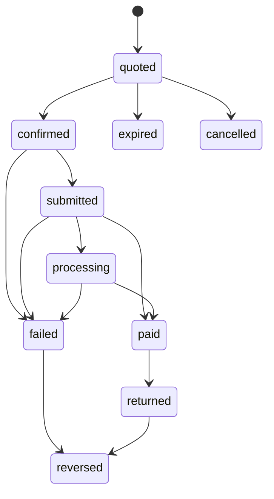

# Onafriq: cross-border payouts

**Status:** the payout system is built and tested end to end against a mock rail. The Onafriq adapter (`backend/app/payouts/onafriq.py`) is a **typed stub**: no Onafriq documentation was available, and we never guess endpoints or formats. Every outbound call refuses with `RailUnavailable`, so nothing is ever reversed on a guess, and every webhook is rejected (`401`) until the `TODO(vendor-docs)` items are filled in. The same `PayoutRail` interface (`app/payouts/rails.py`) is built to take **TCIB** and **Thunes** later.

## Flow: quote → confirm → execute → status → reconcile

1. **Recipients:** `POST /api/payouts/recipients`. A bank account or mobile wallet, validated per country (`app/payouts/validation.py`): currency, account and branch formats, E.164 mobile numbers, operators. Responses only show a masked hint.
2. **Quote:** `POST /api/payouts/quote` with `{sourceWalletId, recipientId, amount (minor units), side: send|receive, purpose}`.
   - Our FX rate and spread are locked for `PAYOUT_QUOTE_TTL_SECONDS` (default 60).
   - The fee comes from the fee engine (product `payout`, per currency/country/method).
   - The rail is asked early, so an unavailable corridor fails before money moves.
   - Shows `sendAmount`, `feeAmount`, `totalAmount`, `receiveAmount`, `fxRate` and `fxSpreadAmount` transparently.
3. **Confirm:** `POST /api/payouts/{id}/confirm` with PIN and `Idempotency-Key`.
   - Expired quote → `409` and status `expired`.
   - KYC level 2 or higher, and KYC-tier limits.
   - Required corridor fields.
   - **Sanctions screening hook** on the recipient: a hit blocks the payout and opens a case.
   - Locked funds check.
   - Posting: `wallet(W) → payout:in_transit(W)` for send + fee.
   - Monitoring rules run.
   - Queues `payout.execute`.
4. **Execute** (worker, outbox): `create_payout` with **our idempotency key**.
   - `RailRejected` (definitive) → `failed` → automatic refund.
   - `RailUnavailable` or timeout → retried with backoff and the same key. Never reversed on a guess.
   - Accepted → `submitted`.
5. **Status webhooks:** `POST /api/webhooks/payouts/onafriq`. Signed and fresh, stored once by event id; duplicates are no-ops.
   - `processing` → status only.
   - `paid` → settle: `in_transit(W) → fees(W)`, `SYS_FX_POOL(W) ⇢ SYS_FX_POOL(R)` with our spread to `SYS_REVENUE_FX(R)`, then `payout:float:onafriq(R)`.
   - `failed` → refund everything to the sender automatically, with a notification.
   - `returned` (after paid) → reverse the settlement, then the debit; everything back.
   - Late or out-of-order events (e.g. `failed` after `paid`) are **refused by the state machine**, recorded as `payout.late_event` in the audit log, and **never move money**. Operations reviews them.
6. **Reconciliation:** daily at 04:00 (`reconcile_payouts`). Yesterday's rail statement is compared with our paid and returned payouts. Results go to `reconciliation_runs` / `reconciliation_items`: `amount_mismatch`, `unmatched_provider` (the rail paid something we don't know about) and `unmatched_ledger` (we think it's paid, the rail doesn't).
7. **Free in-network:** if the recipient's mobile number belongs to a BukkaPay customer, the quote uses rail `internal` with no fee. Confirm books straight into their wallet (FX through the pools if currencies differ) and completes instantly. No rail call is made.

## State machine (`app/payouts/states.py`, audited)



## Ledger (W = sender wallet currency, R = recipient currency; integer minor units converted exactly)

| Step | Debit | Credit |
|---|---|---|
| Confirm | wallet(W) send + fee | payout:in_transit(W) |
| Paid, W = R | payout:in_transit(W) | revenue:fees(W) fee; payout:float:<rail>(W) receive |
| Paid, W ≠ R | payout:in_transit(W); SYS_FX_POOL(R) receive + spread | revenue:fees(W); SYS_FX_POOL(W) send; payout:float:<rail>(R); SYS_REVENUE_FX(R) spread |
| Failed | mirror of Confirm | |
| Returned | mirror of Paid, then mirror of Confirm | |
| In-network | payout:in_transit(W) (+ FX pools) | recipient wallet(R) |

`payout:float:<rail>` is the money we hold at (or owe to) the rail. It runs negative as payouts go out and is topped up when treasury prefunds the rail, booked as a ledger adjustment and confirmed by reconciliation.

## Configuration

| Variable | Default | |
|---|---|---|
| `PAYOUT_RAIL` | `mock` | `onafriq` when live. The mock refuses to run in production. |
| `ONAFRIQ_ENABLED` | `false` | Feature flag |
| `ONAFRIQ_ENV` | `sandbox` | Must be `production` when the API runs in production |
| `ONAFRIQ_BASE_URL`, `_CLIENT_ID`, `_CLIENT_SECRET`, `_WEBHOOK_SECRET` | n/a | Railway secrets only |
| `PAYOUT_QUOTE_TTL_SECONDS` | `60` | FX lock |

## Local end to end with the mock provider server

```bash
cd backend
uvicorn app.main:create_app --factory --port 8000      # API with PAYOUT_RAIL=mock, CARD_ISSUER=sandbox
uvicorn mock_providers.server:app --port 8099           # mock processor + payout rail
curl -X POST localhost:8099/payouts/status -d '{"reference":"MOCK-…","status":"paid"}' -H 'content-type: application/json'
```

The automated tests (`tests/test_payouts.py`, `tests/test_card_provider.py`) cover:
- approve and decline;
- timeouts;
- duplicate webhooks;
- reversals;
- payout failure and return;
- late webhooks;
- bad and stale signatures;
- FX;
- quote expiry;
- KYC;
- in-network transfers;
- reconciliation.

## Runbook

- **Payout stuck in `confirmed`:** the rail is down or answered ambiguously. The outbox retries with the same idempotency key, so it's safe. After the outbox gives up (10 attempts), check `outbox_events.last_error` and ask Onafriq for the status of `payouts.idempotency_key`.
- **Stuck in `submitted` or `processing` for over an hour:** the webhook may be lost. Check the rail's status for `provider_reference`; when `get_status` is implemented, polling resolves this automatically.
- **`payout.late_event` in the audit log:** the rail sent an event that contradicts our state (e.g. failed after paid). No money moved. Confirm with the rail and fix through a maker-checker ledger adjustment if needed.
- **Reconciliation items:**
  - `amount_mismatch`: compare the quote with the rail's statement; FX or fee drift needs a conversation with the rail.
  - `unmatched_provider`: the rail paid something we have no record of. Escalate immediately.
  - `unmatched_ledger`: we booked it paid but the rail doesn't list it. Hold it and check before the next float top-up.
- **Recipient screening blocked a payout:** a compliance case is open; release or reject it in Admin → Compliance.
- **Kill switch:** `ONAFRIQ_ENABLED=false`. Quotes fail with "temporarily unavailable"; payouts already confirmed keep retrying, so nothing is lost.

## TODO(vendor-docs): what we need from Onafriq

1. Auth scheme (OAuth client credentials? API key? request signing? mTLS?) and base URLs for sandbox and production.
2. Corridors and methods: country/currency/method identifiers; bank codes and branch codes; mobile operator codes; account validation (name lookup) endpoint.
3. Quotes and FX: does Onafriq convert, or do we prefund in the receive currency? Rate validity, fee model.
4. Create payout: endpoint, **idempotency** header or field, sender and beneficiary fields per corridor (bank vs mobile wallet), amount format (minor units?), purpose codes, response reference and status.
5. Status: status vocabulary (map to processing / paid / failed / returned), status lookup endpoint.
6. Webhooks: envelope (event id), signature header, algorithm, signed content, replay window, retry policy.
7. Returns and recalls: how a returned payout is reported and how quickly.
8. Statements: settlement report or statement API/SFTP format, cut-off time zone, prefunding and float top-up process.
9. Mandatory per-corridor compliance fields (sender ID, address, relationship, recipient ID) to fill in `validation.required_extra`.
10. Limits per corridor and method (minimum/maximum, daily caps).
