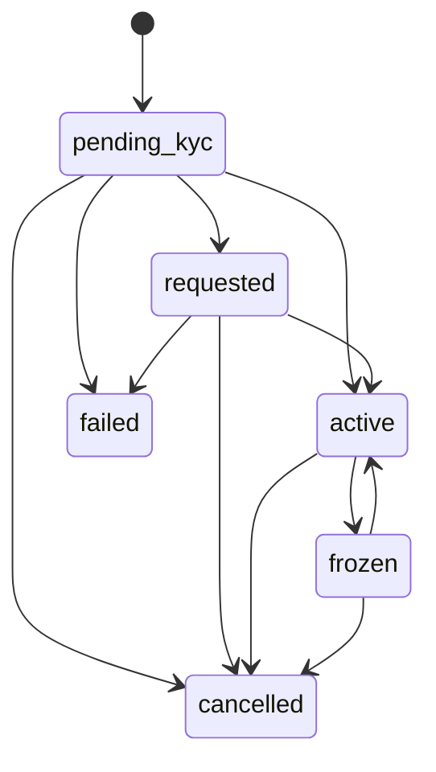
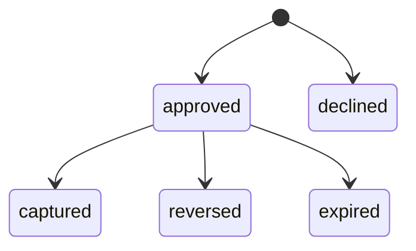
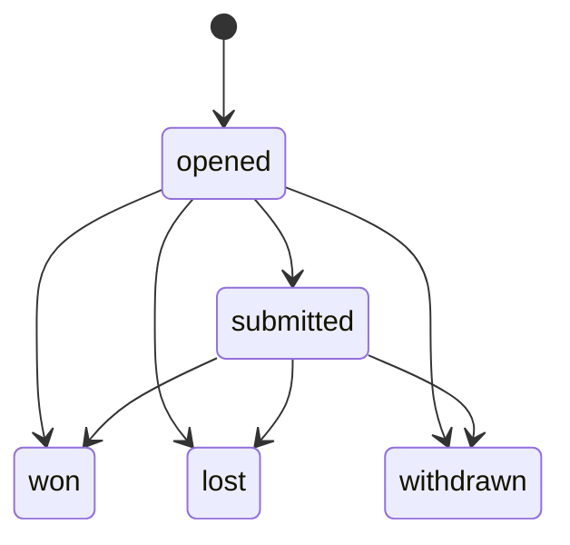

# Paymentology: virtual cards

**Status:** the provider-neutral card system is built and tested. The Paymentology adapter (`backend/app/cards/paymentology.py`) is a **typed stub**: no Paymentology documentation was available, and we never guess endpoints or formats. Every outbound call refuses (`IssuerUnavailable`) and every inbound call is rejected (`401`) until the `TODO(vendor-docs)` items below are filled in. Filling in that one file is the whole go-live change.

## Design

- **One virtual card per customer.** It spends from the customer's **active wallet**, which defaults by country (ZA→ZAR, BW→BWP, ZW→USD; otherwise the default wallet). The customer can switch it in the app (PIN; audited). Switching is blocked while a card overdraft is unpaid.
- **We are out of PCI scope.** We store only the provider card id, last 4, expiry month/year, status and controls. Showing full details uses the processor's secure display (`reveal()` → `kind: "hosted"`). PAN and CVV never pass through our servers or logs.
- **Money moves only through the ledger** (`app.ledger.posting.post`): balanced per currency, never a direct balance update.

### Authorization (real-time)

`POST /api/card-issuer/paymentology/authorize` (and `/webhooks/card/auth` with `X-Card-Issuer: paymentology`)

1. The adapter verifies the signature (`verify_webhook`) and normalizes the payload (`parse_authorization`).
2. The decision is idempotent on the processor's authorization id: a retry gets the original answer.
3. Checks, in order:
   - card status (`frozen`, `inactive`);
   - customer and wallet restrictions;
   - phone-wallet token is live and belongs to this card;
   - channel controls (online, contactless, chip, ATM, international);
   - blocked merchant categories;
   - per-transaction and daily limits;
   - KYC-tier limits (`TransactionLimit`, admin-configurable);
   - fraud rules: velocity (more than 5 in 2 minutes) and high-risk merchant categories (gambling, quasi-cash, money transfer) below KYC level 3.
4. Fees: ATM or foreign-transaction fee from the fee engine (per currency/country, admin-configurable).
5. **FX:** when the active wallet's currency (W) differs from the card's billing currency (B), we quote `quote_for_target(W→B)` with our spread. The rate, spread and W amount are **locked on the authorization**.
6. **Hold:** `wallet(W) → card:holds(W)`. Insufficient funds → `insufficient_funds`.
7. **Timeout budget** (`PAYMENTOLOGY_AUTH_BUDGET_MS`, default 1500 ms): if deciding took longer than the processor waits, the decision is **rolled back** and we answer `issuer_timeout`. No hold is ever left for an answer the processor didn't use. A retry with the same id is decided afresh.

### Settlement events

`POST /api/card-issuer/paymentology/events` (signed; event ids stored once in `provider_webhooks`, so duplicates are no-ops)

| Event | Effect |
|---|---|
| `transaction.cleared` | Hold → final posting in the **funding wallet's currency at the locked rate**, even if the customer switched wallets since. The W→B bridge runs through `SYS_FX_POOL`; our spread goes to `SYS_REVENUE_FX(B)`; fees to `revenue:fees(B)`. Clearing above the hold → overdraft receivable, card frozen until repaid. Force-posts without an authorization use today's rate. |
| `authorization.reversed` | The same share of the hold back to the funding wallet. |
| (expiry job) | Holds never cleared after 7 days (31 for hotels/car hire) are released. |
| `transaction.refunded` | Credited to the current active wallet at the **mid rate, no spread**. |
| `dispute.submitted` / `won` / `lost` | Dispute outcome (below). |

### Disputes (chargebacks)

Customer: `POST /api/issued-cards/{id}/disputes` (within 120 days, one per payment). Admin: `GET /api/admin/cards/disputes`, `POST /api/admin/cards/disputes/{id}` with outcome `submitted | won | lost`. A win credits the customer **once** (chargeback posting from the issuer settlement account).

### State machines (audited, `app/cards/states.py`)

Any undeclared transition is refused (`409 invalid_state`), and every real change writes an `audit_logs` row.

### Ledger summary (W = funding wallet currency, B = billing currency)

| Step | Debit | Credit |
|---|---|---|
| Authorize | wallet(W) | card:holds(W) |
| Capture, W = B | card:holds | card:payable:paymentology, revenue:fees |
| Capture, W ≠ B | card:holds(W); SYS_FX_POOL(B) | SYS_FX_POOL(W); card:payable(B); revenue:fees(B); SYS_REVENUE_FX(B) |
| Reverse / expire | card:holds(W) | wallet(W) |
| Refund / chargeback won | card:payable(B) (+ FX pools if W ≠ B) | wallet |

## Configuration

| Variable | Default | |
|---|---|---|
| `CARD_ISSUER` | `sandbox` | Set to `paymentology` to use the adapter |
| `PAYMENTOLOGY_ENABLED` | `false` | Feature flag; off means every call refuses |
| `PAYMENTOLOGY_ENV` | `sandbox` | `production` is required when the API runs in production |
| `PAYMENTOLOGY_BASE_URL`, `_API_KEY`, `_API_SECRET`, `_PROGRAM_ID`, `_WEBHOOK_SECRET` | n/a | Railway secrets only; never committed |
| `PAYMENTOLOGY_AUTH_BUDGET_MS` | `1500` | Set below Paymentology's real-time auth timeout |

## Runbook

- **Customer says a payment was declined:** Admin → Cards → the card's authorizations show `declineReason` (`insufficient_funds`, `card_frozen`, `suspected_fraud`, `fx_unavailable`, `issuer_timeout`, …).
- **Many `issuer_timeout` declines:** check API latency and database load; raise `PAYMENTOLOGY_AUTH_BUDGET_MS` only if Paymentology's own timeout allows it.
- **`fx_unavailable`:** the W→B pair is inactive or has no rate in Admin → FX. Customers switched to that wallet can't pay until it's restored.
- **Webhook `401`:** signature failed or the event is older than 5 minutes (replay protection). Check `PAYMENTOLOGY_WEBHOOK_SECRET` and clock skew.
- **Overdraft (clearing above the hold):** the card freezes automatically; the worker collects from the wallet on the next top-up and unfreezes it.
- **Dispute:** submit to Paymentology, record the outcome in Admin; `won` credits the customer once.
- **Kill switch:** `PAYMENTOLOGY_ENABLED=false`. New authorizations decline at the processor; nothing else changes.

## TODO(vendor-docs): what we need from Paymentology

1. Auth scheme for our outbound calls (API key/secret? signed requests? mTLS?) and base URLs for sandbox and production.
2. Card creation: endpoint, required fields (program/product id, cardholder, currency, virtual form), idempotency mechanism, response fields (card id, last 4, expiry).
3. Card status changes: freeze/unfreeze/terminate endpoints and their status vocabulary.
4. Secure card display: the hosted page or tokenised display SDK flow (session URL/token, expiry).
5. Real-time authorization or JIT funding: request format, response format, **timeout**, stand-in rules when we don't answer, partial approvals.
6. Event webhooks: envelope (id, type), clearing/presentment, reversal, refund, expiry, chargeback, token events; signature header, algorithm, replay window.
7. Push provisioning to Apple Pay / Google Pay; token lifecycle events.
8. Settlement: currency of settlement, daily settlement report format (for reconciliation), and whether a card can bill in several currencies (to avoid double FX).
9. Supported billing currencies for our programme (ZAR, BWP, USD).
